# ai-job-search-n8n

A self-hosted, **near-zero-cost** job-search assistant. It collects jobs from several boards, removes duplicates, filters out the obvious misses for free, scores the rest with a cheap model, and, **if you want it**, spends real tokens tailoring your resume and writing a cover letter for the jobs worth applying to. You review on Telegram or the command line and **apply by hand**: there is no auto-apply.

**Use only what you want.** The core is collect → dedupe → filter → score. Tailoring, Telegram and the daily digest are optional and independent, and each has a fallback: stop at scoring and read your shortlist in the database or a spreadsheet; skip Telegram and review at the command line; skip Gmail-style tracking and set the status yourself. See [Use only what you want](#use-only-what-you-want).

Built with [n8n](https://n8n.io), PostgreSQL, a small Python service ([JobSpy](https://github.com/speedyapply/JobSpy) plus the pipeline logic), the Claude API, and Docker. It runs on a free-tier VM (for example Oracle Cloud Always Free, ARM).

> **Status: working end to end, still growing.** Collect → dedupe → filter → score → tailor → review is live, with company job boards, remote feeds and a web dashboard (jobs, health, spend, settings, search; works on a phone). Gmail status tracking is planned. See [what works today](#what-works-today) and the [roadmap](docs/roadmap.md).

## Set it up the easy way: let your AI assistant do it

Open this repository in an AI coding assistant (Claude Code, Cursor, Codex, Copilot, Windsurf, ...) and say:

> **Set this project up for me. Read `AGENTS.md` and `docs/setup-with-ai.md`, then ask me for whatever you need.**

It will ask you where you want to run it (your computer, a server you have, or a free Oracle Cloud server it can walk you through), for your resume and LinkedIn data, what jobs you are looking for, and which optional parts you want, then build everything and verify it. The few things only you can do are an [Anthropic API key](https://console.anthropic.com) (typed into `.env` by you, never pasted into the chat) and, if you want it, a free Telegram bot. Prefer to do it yourself? Follow the [quick start](#quick-start) below or the full [setup guide](docs/setup.md).

## What you get

Once it is set up, with no further effort from you:

- **Every 6 hours** it searches Indeed, Naukri and LinkedIn (optionally LinkedIn via Apify) for your target roles and locations. *(core)* You can also switch on **more sources**: the job boards of companies you name (Greenhouse, Lever, Ashby, Workable, SmartRecruiters) and five remote-job feeds. They are free, and off until you ask ([more sources](#more-sources)).
- **Every 30 minutes** it scores new jobs 0-100 against your profile (about $0.0003 per job). *(core)*
- **Every 15 minutes** it tailors your resume and writes a cover letter for each shortlisted job (about $0.05 per application). *(optional: tailoring)*
- **Every morning** it sends a digest of new matches, with warnings (closing soon, suspicious posting, eligibility unclear). *(optional: Telegram)*

Those times are **defaults**: every schedule, and how much each run does, is a setting (`scripts/jobsearch schedule set collect --every 3h`, `schedule set digest --at 07:30`), applied within 5 minutes with no restart.

You decide with `/approve`, `/skip` and `/applied` on Telegram, or the same commands in the terminal; apply on the employer's site yourself, and record how it went with `mark 24 interview`. Spend is logged and **hard-capped** (default $10 a month).

**Optional web dashboard** (free, password-protected, listens on `127.0.0.1` only): **Jobs** (your numbers, charts, every job, a status menu for each stage of an application, details and PDFs), **Health** (is everything running, with a pause button), **Spend** (Claude and Apify against their caps), **Settings** (schedules, optional parts, tailoring, caps you can lower) and **Search** (what to search for, sources, company boards, "find a company"). It opens in dark mode, fits a phone, and you reach it through an SSH tunnel or, for your phone, Tailscale ([docs/dashboard.md](docs/dashboard.md)).

## More sources

Every source is one switch, and you pick which ones to use:

```bash
scripts/jobsearch sources                      # what is on, what it costs, how many jobs each has brought
scripts/jobsearch sources only apify           # just Apify's LinkedIn search
scripts/jobsearch sources off boards           # stop reading company boards
scripts/jobsearch boards find "Stripe"         # which job board a company uses, and the line to add
```

Besides Indeed, Naukri and LinkedIn you can read the public job boards of **companies you list** (Greenhouse, Lever, Ashby, Workable, SmartRecruiters) and **remote feeds** (Remotive, RemoteOK, We Work Remotely, Himalayas, Arbeitnow). They cost nothing to fetch (the only cost is scoring the new jobs they bring), are fetched politely, and run only when you switch them on. **When updating an existing install, run `scripts/jobsearch migrate` first and rebuild the scraper afterwards** ([upgrading](docs/setup.md#upgrading)). Companies with their own career site or on Workday (Amazon, Google, Meta, ...) are not covered. See **[docs/sources.md](docs/sources.md)** and [choosing your sources](docs/customization.md#choosing-your-sources).

## Use only what you want

| Setup | You get | You need | Cost |
|---|---|---|---|
| **A. Scoring only** | a scored, deduplicated shortlist in your database; list it, open one in detail, export a CSV | Anthropic key | about $0.0003 per job |
| **B. + tailoring, review at the CLI** | A, plus a tailored resume and cover letter per shortlisted job, as files | same | + about $0.05 per application |
| **C. + Telegram** | B, plus a phone: digest, review, commands | + a free Telegram bot | same as B |

```bash
scripts/jobsearch features                                   # what is on
scripts/jobsearch features set --tailoring off --telegram off   # setup A
scripts/jobsearch features set --telegram off                   # setup B
scripts/jobsearch features set --tailoring on --telegram on     # setup C
```

No Telegram configured? It is simply off, and nothing breaks. No tailoring? The pipeline stops at scoring. No Gmail? Set the stage by hand. Every choice, the fallback for each part, and recipes are in **[docs/customization.md](docs/customization.md)**.

## How it works

```mermaid
flowchart LR
    A[Sources<br/>JobSpy · Apify<br/>company boards · feeds] --> B[Safety check<br/>scams · injection]
    B --> C[Dedupe<br/>across boards]
    C --> D[(Postgres)]
    D --> E[Free filters<br/>title · years · age · location]
    E --> F[Score<br/>cheap model, 0-100]
    F -->|score ≥ threshold| G[Tailor<br/>resume patch + cover letter]
    G --> H[Honesty checks<br/>audit + fact check]
    H --> I[PDFs]
    I --> J[You<br/>Telegram / CLI]
    J -->|apply manually| K[(applications)]
```



1. **Many sources, one shape.** Every source adapter returns the same job fields, so adding a board never changes the rest.
2. **Safety first.** Postings are untrusted: scam patterns and prompt-injection attempts are caught before any model sees the text ([safety](docs/safety.md)).
3. **Dedupe before spending.** A job listed on four boards is processed once ([dedupe](docs/dedupe.md)).
4. **Free filters, then a cheap model, then a strong one.** Only jobs above your threshold reach the expensive step.
5. **The AI edits JSON, not layout.** Your resume is structured data; the model returns a small patch (reorder, hide, reword) that is checked against your real resume and rendered through a fixed template. It must not invent anything ([tailoring](docs/tailoring.md)).
6. **A human stays in the loop**, and **a hard budget** sits under every paid call ([budget](docs/budget.md)).

n8n only schedules and calls things. All the rules live in the Python service, where they are unit-tested ([architecture](docs/architecture.md)).

## What works today

| Area | State |
|---|---|
| Collect from Indeed, Naukri, LinkedIn (JobSpy) and LinkedIn (Apify, three accounts, credit-aware) | ✅ live |
| **Company job boards** (Greenhouse, Lever, Ashby, Workable, SmartRecruiters) and **remote feeds** (Remotive, RemoteOK, We Work Remotely, Himalayas, Arbeitnow); every source one switch (`scripts/jobsearch sources`, or the dashboard's Search page), free to fetch, a free relevance filter before scoring | ✅ live; off until you switch it on |
| Scam and prompt-injection checks, risk label on every job | ✅ live |
| Cross-board dedupe, free rule filters (title words, years of experience, age, companies) | ✅ live |
| Scoring with a rubric, eligibility/language/location gates computed in code | ✅ live |
| Spend logging and hard monthly/daily caps | ✅ live |
| Tailored resume + cover letter, honesty checks, PDF rendering | ✅ live |
| Review by Telegram commands and CLI; daily digest | ✅ live |
| `/setup`, `/doctor`, `/status`, `/check`, `/budget`, `/tailor`, `/review`, `/features`, `/jobs`, `/mark`, `/schedule`, `/sources` in Claude Code, and the `jobsearch` CLI | ✅ live |
| **Optional parts:** switch tailoring, Telegram and the digest on or off; no-Telegram review path; manual status tracking; shortlist browsing and CSV export | ✅ live |
| **Customizable schedules:** when each stage runs and how much it does, the scoring model, timezone, run-now; paper size and writing-style notes for tailoring | ✅ live |
| Gmail status tracking (interview / rejection / offer detection), optional; manual tracking works today | ⬜ planned |
| Adzuna and Jooble (free API key) | not built yet |
| **Web dashboard** (optional): jobs with filters, charts, CSV export, details and PDFs, status editing; a health page with a pause button; a spend page; a settings page (schedules, optional parts, tailoring, caps you can lower); a search page (profile, sources, company boards); phone layout; password-protected, with its own low-privilege database role ([dashboard](docs/dashboard.md)) | ✅ live; a Kanban board and requeue button are planned |
| Interview prep, company research | ⬜ optional |

Details and the history of each phase: [docs/roadmap.md](docs/roadmap.md).

## Quick start

You need a machine with Docker and Docker Compose (your own computer; on Windows use WSL 2) or an always-on Linux server (a free Oracle Cloud one works: [docs/vm-oracle.md](docs/vm-oracle.md)), plus `git`, `openssl` and `python3` (3.10+) where you type the commands, and an [Anthropic API key](https://console.anthropic.com) (a prepaid-credit API account, not a Claude subscription). A Telegram bot (free, 2 minutes with @BotFather) is **optional**. The full, step-by-step walkthrough is **[docs/setup.md](docs/setup.md)**; the short version:

```bash
git clone https://github.com/Abhishek260305/ai-job-search-n8n.git
cd ai-job-search-n8n

scripts/init-env.sh                   # creates .env with random secrets
nano .env                             # set TZ and ANTHROPIC_API_KEY (Telegram lines are optional; leave empty to skip)
                                      # (scripts/set-env.sh ANTHROPIC_API_KEY asks for a key with the typing hidden)
docker compose up -d --build          # starts Postgres, n8n, the Python service, the PDF renderer

# server installs only: scripts/tunnel.sh user@your-host   (a local install needs no tunnel)
# open http://localhost:5678 and create the n8n owner account (8080 is the optional dashboard)

scripts/n8n-credentials.sh            # puts your keys into n8n, encrypted
scripts/n8n-import-workflows.sh       # installs the workflows (not started yet)
```

Then run **`/setup`** in Claude Code (or copy the `config/*.example.json` files and edit them) to describe your resume and what you are looking for, and finally start the schedules and check everything:

```bash
scripts/n8n-import-workflows.sh --publish   # starts the schedules (Telegram ones only if configured)
scripts/jobsearch schedule timezone <your time zone>   # for example America/New_York: when the digest arrives
scripts/jobsearch doctor
```

The examples and the default sources lean towards India (Indeed, Naukri, example locations such as Pune); everything is configurable, and bare city names without a country are only matched for India ([sources](docs/sources.md)). Change the locations and sources in `config/search.json` for your market.

Want the web dashboard too? `scripts/init-env.sh --add-dashboard`, then `docker compose up -d --build --no-deps dashboard-db-init dashboard`; the same tunnel opens it at <http://localhost:8080> ([setup step 11](docs/setup.md#11-enable-the-dashboard-optional)). And set up nightly backups with `scripts/backup.sh` ([setup, backups](docs/setup.md#backups)).

## Using it day to day

Read [docs/daily-use.md](docs/daily-use.md): what runs by itself, what you do each day, the Telegram commands, and the settings you can change (schedules, automatic vs on-demand tailoring, approval vs auto-store, score bands, daily limits).

## Documentation

Start at the **[documentation index](docs/README.md)**. Highlights:

| I want to... | Read |
|---|---|
| have my AI assistant set it up for me | [setup with an AI assistant](docs/setup-with-ai.md) |
| install and configure it myself | [setup](docs/setup.md) |
| get a free always-on server | [Oracle Cloud Always Free](docs/vm-oracle.md) |
| change schedules, turn parts off, or run without Telegram, tailoring or Gmail | [customization](docs/customization.md) |
| use it every day | [daily use](docs/daily-use.md) |
| know every command | [commands](docs/commands.md) |
| understand tailoring and why I can trust it (and where not to) | [tailoring](docs/tailoring.md) |
| control or understand the spend | [budget](docs/budget.md), [costs](docs/costs.md) |
| fix something | [troubleshooting](docs/troubleshooting.md) |
| see what is built and what is next | [roadmap](docs/roadmap.md) |
| turn on, open or troubleshoot the web dashboard | [dashboard](docs/dashboard.md) |
| add a job source | [adding a source](docs/adding-a-source.md) |

## Repository layout

```
docker-compose.yml        postgres, n8n, scraper (the Python service), gotenberg (HTML → PDF); the optional dashboard (profile "dashboard")
postgres/schema.sql       baseline tables and the upsert_job() dedupe function
postgres/migrations/      numbered SQL migrations (postgres/migrate.sh); postgres/tests/ checks them
scraper/                  the Python service: sources (JobSpy, Apify, company boards, feeds), safety, filters, scoring, tailoring, rendering, Telegram, budget
dashboard/                the optional web dashboard: api/ (FastAPI), web/ (React), Dockerfile, db-init.sh
workflows/                the six n8n workflows (importable JSON): a scheduler plus the pipeline
config/                   *.example.json files; your real resume/profile/search files are gitignored
scripts/                  jobsearch (CLI), init-env, set-env, tunnel, n8n-credentials, n8n-import-workflows, backup, check-secrets, test
cli/                      the CLI core (standard library only) and its tests
.claude/commands/         Claude Code slash commands: /setup /doctor /status /check /budget /tailor /review /features /jobs /mark /schedule /sources
docs/                     everything else (start at docs/README.md)
AGENTS.md, CLAUDE.md      instructions for AI assistants (how to set the project up for a user, and the working rules)
output/                   your generated applications (gitignored, created on first run)
```

## Cost

Self-hosted n8n and Postgres, free scraping (including company boards and remote feeds), and Telegram are free. The only money is Claude API usage: about **$0.0003 per scored job** and **$0.05 per tailored application**, capped by you (default $10 a month, enforced in the app and, if you set it, by the Anthropic Console). Apify's free monthly credit is optional. See [docs/costs.md](docs/costs.md).

## Responsible use

- Scraping may violate a job board's terms of service. You are responsible for how you use this. Prefer official APIs (ATS public job-board endpoints, Adzuna, ...) where you can; the company boards and remote feeds this project reads are public endpoints, are fetched with minimum gaps between requests, and the jobs keep their original link and source name for your own private search.
- Never put your own LinkedIn credentials into any scraper; risking your account is not worth it.
- Keep your resume, profile and API keys out of git. `.gitignore` is set up for this, and `scripts/check-secrets.sh` double-checks what a commit would publish (run it before every push).
- Read every generated document before you send it. The honesty checks are strong, not perfect.
- This tool prepares applications; **you** review and submit them.

## Contributing

Issues and pull requests are welcome, especially new source adapters ([docs/adding-a-source.md](docs/adding-a-source.md)). Run `scripts/test.sh` and `scripts/check-secrets.sh` before you open one. Ideas adapted from other MIT projects are credited in [THIRD_PARTY_NOTICES.md](THIRD_PARTY_NOTICES.md).

## License

[MIT](LICENSE)
