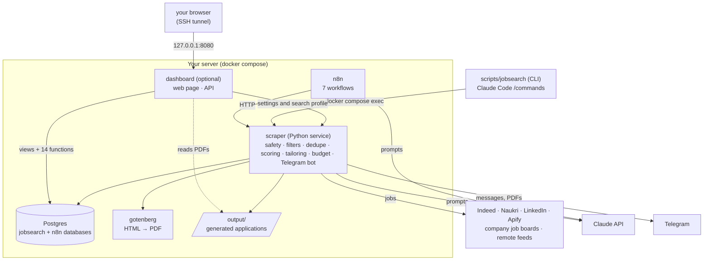

# Architecture

## The one-minute version

**n8n schedules; the Python service decides.** n8n runs seven small workflows that call HTTP endpoints on a Python service. The service holds every rule (safety, filters, dedupe, scoring, tailoring, budget, Telegram) and talks to Postgres. Because the rules are ordinary tested Python and SQL, you can run them from the CLI, from Claude Code or from n8n and get the same answer.



## Components

| Component | Role | Reachable from outside? |
|---|---|---|
| **n8n** | Runs seven workflows: a scheduler that starts the pipeline stages when the schedule settings say so, the stages themselves (one of them, `06 Check mail`, belongs to the optional Gmail part and does nothing until it is on), and the Telegram poll; makes the scoring calls to Claude and sends the daily digest | `127.0.0.1:5678` only (use an SSH tunnel) |
| **scraper** (Python/FastAPI, the folder is `scraper/`) | All the logic: source adapters (JobSpy, Apify, company job boards, remote feeds), safety, dedupe/ingest, free filters, scoring rules, tailoring, rendering, the Telegram bot, the budget guard | internal network only |
| **PostgreSQL 16** | Two databases: `n8n` (n8n's own) and `jobsearch` (our data and many of our rules, as SQL functions) | internal network only |
| **gotenberg** | Headless Chromium that turns the resume and cover-letter HTML into PDFs | internal network only |
| **Claude API** | A Haiku-class model scores jobs and fact-checks tailored text; a Sonnet-class model tailors | outbound only |
| **Telegram** | Your review and command channel (polled, so no public URL is needed) | outbound only |
| **Apify** (optional) | Hosted LinkedIn scraping, to get around datacenter-IP blocks | outbound only |
| **`scripts/jobsearch`** | The CLI core (standard library only); the slash commands in `.claude/commands/` are thin wrappers over it | runs next to the stack, or over SSH |
| **dashboard** (optional; FastAPI + a React page, the folder is `dashboard/`) | A password-protected web page: summary, charts, the jobs table and details, status changes, health, spend, the pause switch, and the Settings and Search pages. It holds no rules: it reads views and calls six SQL functions as its own `jobsearch_dashboard` role, calls the scraper's own settings and search-profile endpoints (a fixed list of paths, through `dashboard/api/scraper_client.py`) so the CLI's rules apply, and reads `output/` read-only for the PDFs ([dashboard.md](dashboard.md)) | `127.0.0.1:8080` only (use an SSH tunnel) |

Nothing is published to the internet. If you later need public webhooks (Telegram buttons, Google OAuth redirects), put a reverse proxy or a Cloudflare Tunnel in front deliberately.

## Core and optional parts

Collect → safety → dedupe → filter → score is the **core** and always runs. Tailoring, Telegram and the digest are **optional**, switched in `feature_settings` and combined with what is configured (`scraper/features.py`: `effective()` says what is actually on and why anything is off). Each optional stage degrades to a plain database state instead of failing: with tailoring off, shortlisted jobs just wait as `shortlisted`; with Telegram off, nothing is sent and approval falls back (`review` → `auto`, or `cli`); decisions and later stages are recorded by hand through `review_application()` and `set_application_status()`, which create a files-less "base" application when there is none. See [customization.md](customization.md).

The **dashboard** is optional in a different way: it is a separate container behind a compose profile (`COMPOSE_PROFILES=dashboard`), so without it nothing of it runs at all, and nothing in the pipeline depends on it.

## Why a hybrid (and not all-n8n)

n8n is good at schedules, retries and glueing services; it is poor at code that needs unit tests. Scoring gates, scam rules, dedupe, the grounding audit and the budget guard are exactly the logic you must be able to test and diff. So the workflows stay thin HTTP calls, and a change to a rule is a tested change to Python or SQL, not an edit to a canvas. The workflows are also easy to read: each is a handful of nodes.

## The pipeline, step by step

```
collect → safety → dedupe/upsert → free filters → score → threshold → tailor → honesty checks → render → review → apply (you) → track
```

| # | Stage | What happens | Who runs it |
|---|---|---|---|
| 1 | **Plan** | A rotating cursor picks the next slice of (title × location × source) from your search settings; Naukri is used only for India, Indeed only in countries it supports. If you switched on company job boards or remote feeds, a second rotating slice lists one `/fetch/board` request per company or feed ([sources.md](sources.md)) | workflow 01 |
| 2 | **Collect** | Each source adapter returns jobs in one normalised shape; a failing source is reported and skipped, never fatal. Company-board and feed jobs first pass a free relevance filter (title, location, age) | workflow 01 |
| 3 | **Safety** | Link/host classification, scam red flags, prompt-injection signals, a `low/medium/high` risk label; high-risk is blocked before any model call ([safety.md](safety.md)) | service |
| 4 | **Dedupe / upsert** | `upsert_job()` decides if this is a known job, across boards ([dedupe.md](dedupe.md)) | Postgres |
| 5 | **Free filters** | Excluded title words, years of experience, age, companies, remote; a reason is stored for every drop | service |
| 6 | **Score** | A cheap model reports facts about the fit; the score, verdict and gates are **computed in code** ([scoring.md](scoring.md)) | workflow 02 + service |
| 7 | **Threshold** | `score >= score_threshold` makes a job `shortlisted` | service |
| 8 | **Tailor** | A stronger model returns a **patch** to your resume JSON and a cover letter; only facts already in your resume are allowed | workflow 04 + service |
| 9 | **Honesty checks** | A deterministic audit, one revision, repair, then a Haiku fact check ([tailoring.md](tailoring.md)) | service |
| 10 | **Render** | HTML → PDF through Gotenberg, fitted to the page limit and verified (page count, text layer) | service + gotenberg |
| 11 | **Review** | Telegram message with the PDFs; you `/approve` or `/skip` (or approval is automatic if you chose that) | workflow 04/05 + service |
| 12 | **Apply** | You, on the employer's site; then `/applied` | you |
| 13 | **Track** | *Optional:* a Gmail workflow (06) reads replies read-only and proposes status changes, written only after your approval on the Email page ([gmail.md](gmail.md)) | workflow 06 + service |

Every paid call in steps 6, 8 and 9 goes through the **budget guard**: priced at its worst case first, refused if it would break a cap, and logged with the provider's real token counts afterwards ([budget.md](budget.md)).

## Data model

Defined in [`postgres/schema.sql`](../postgres/schema.sql) and the numbered files in [`postgres/migrations/`](../postgres/migrations/).

| Table / object | Holds |
|---|---|
| `jobs` | one row per real-world posting: pipeline `status`, score and verdict, safety label and flags, filter reason, dedupe fingerprints, deadline, years of experience |
| `job_sources` | one row per listing on a specific board, pointing at its canonical job; keeps the raw payload |
| `search_profile` | what to search for and the free filters, including the score threshold, the company boards to read and the extra title words for them |
| `collect_cursor` | where the rotating search plan stopped, so each run takes the next slice (the company boards and feeds have their own cursor) |
| `fetch_state` | when each company board or feed was last fetched and whether it worked: the minimum gap between fetches and the doctor's "keeps failing" warning |
| `applications` | one per tailored job: status, files, the patch that was applied, requirement coverage, the audit result, a "needs attention" flag, cost, review notes |
| `tailor_settings` | your tailoring choices (mode, approval, score band, limits, model) |
| `llm_usage`, `model_pricing`, `budget_settings` | every paid call, the price table, and your caps; `budget_status()` is what the guard reads |
| `feature_settings` | the switches for the optional parts: tailoring, Telegram, digest |
| `schedule_settings` | when each stage runs (every N minutes, or daily at a time), how much one run does, the scoring model, run-now requests; `claim_due_schedules()` hands out what is due, atomically |
| `telegram_state` | the poll offset, so a command is never handled twice |
| `v_shortlist`, `v_review_queue`, `v_spend_month` | the views behind `status`, `review` and `budget` |
| `v_dashboard_jobs`, `v_dashboard_job_detail`, `v_dashboard_job_sources` | the dashboard's read-only views of jobs, one job's details and its listings (migration 014) |
| `dashboard_summary()`, `dashboard_set_status()`, `dashboard_application_file()` | the dashboard's other database access (migration 014): the card and chart counts, a status change that refuses if the job changed since the page loaded (then calls `set_application_status()`), and the path of a generated PDF |
| `dashboard_move_status()`, `dashboard_undo_status()` | migration 020: the status change that also names the history entry it wrote, and the undo that takes back the newest history entry of a job when it was made on the dashboard and the job has not moved since (the status, applied date and note go back as they were, and the entry is removed). The entries carry their starting point for this |
| `dashboard_job_events()`, `dashboard_board()`, `dashboard_stats()` | migration 018: the timeline of one job, the Kanban board's cards and totals, and the response rate and weekly numbers. The history itself is the table `application_events`, written by a trigger on `applications` (the role cannot read it) |
| `dashboard_job_tracking()`, `dashboard_set_tracking()`, `dashboard_set_follow_up_days()` | migration 019: your notes, contact, referral and follow-up date for a job (saved only if the row is as you last read it), and the days setting. The data is in `job_tracking` and `follow_up_settings`; `follow_ups_due()` is the rule for what is due (also used by the scraper's digest and `jobsearch follow-up`). The role cannot read these tables |
| `dashboard_health()`, `dashboard_spend()`, `dashboard_set_pause()` | migration 016: the Health page's checks and alerts, the Spend page's meters and per-day figures, and the pause switch (the dashboard's only write besides a status; the same switch as `schedule pause`) |
| `jobsearch_dashboard` (role) | the dashboard's login: `SELECT` on the three views and `EXECUTE` on the fourteen functions, nothing else. Created `NOLOGIN` by migration 014; the `dashboard-db-init` service gives it a password from `.env` |

Business rules are SQL functions where atomicity matters (`upsert_job`, `claim_jobs_to_score`, `record_score`, `claim_jobs_to_tailor`, `save_application`, `review_application`, `record_usage`) so concurrent workflow runs cannot double-process a job. The dashboard's functions are `SECURITY DEFINER`, so its role never needs privileges on the tables themselves.

## Design choices that keep it cheap and safe

- **Cheapest first.** Dedupe and free filters run before any model; scoring uses the smallest capable model and stores the result so a job is never re-scored; only the shortlist reaches the strong model.
- **Patches, not rewrites.** Tailoring returns a small JSON patch over your resume: fewer output tokens and far less room to invent.
- **Computed, not trusted.** The model reports; code decides. A posting that tries to talk the model into a high score changes nothing.
- **Untrusted input everywhere.** Posting text is stripped of hidden content, fenced and never obeyed.
- **Prompt caching.** The static part of each prompt (instructions plus your resume or profile) comes first so caching can apply; it only activates above a model-specific minimum size.
- **At-most-once and single-flight** for anything with side effects (Telegram commands, tailoring one job) so retries cannot send twice.
- **A hard budget** at two layers: the app, and the provider's own limit.
- **A human sends everything.** No auto-apply, no auto-email.
