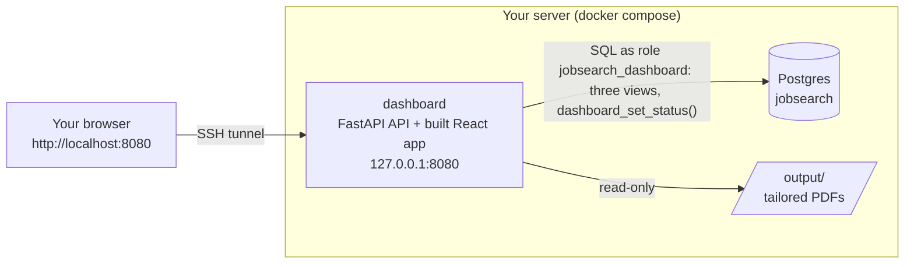

# Dashboard (web UI)

A browser view of everything the pipeline knows, so you do not have to open Postgres, the CLI or Telegram to see where your search stands. **Status: versions 1 and 2 (Jobs, Health with the pause switch, Spend, Settings and Search) are built, tested and in use. Version 3 and later are not built.** To open it, see [Open the dashboard](#open-the-dashboard); to add it to an install, see [Turn it on](#turn-it-on). Later versions are listed at the end so the work can be picked up in order.

The dashboard is optional, like every part beyond scoring. The CLI, Telegram and the database keep working exactly as they do today, with or without it.

## Decisions already made

| Question | Decision | Why |
|---|---|---|
| Frontend stack | **React + Vite + TypeScript** | The table (filters, sorting, inline status edits, a details panel), the settings forms of version 2 and the Kanban board of version 3 are all much simpler with React and its libraries. TypeScript catches mismatches between the API and the screens. |
| Backend | **Python 3.12 + FastAPI + psycopg**, like the `scraper` service | Keeps the repo to one backend language with one test setup. FastAPI publishes an OpenAPI schema, from which the frontend's TypeScript types are generated, so the two cannot drift apart. Go would also work but adds a third toolchain for no gain at one user and a few thousand rows. |
| Where the build runs | **Inside the Docker image build** | Users never install Node. The image is built with a Node stage and served by a small Python stage. |
| How you open it | **SSH tunnel**, like n8n | The dashboard shows your resume files, salaries and pipeline, and later can change settings. It is bound to `127.0.0.1` on the server and never published to the internet. Tailscale (free) gives phone access without opening a port: see [Opening it from a phone](#opening-it-from-a-phone-without-ssh-tailscale). |
| Version 1 scope | **Summary cards, charts, the jobs table with status editing, the job details panel** | The most useful part first. Settings, health and spend panels come in version 2. |

## Version 1 at a glance

```
┌──────────────────────────────────────────────────────────────────────────────┐
│ Job search                                       last updated 23:25  [Export] │
├──────────┬──────────┬──────────┬──────────┬──────────┬──────────┬────────────┤
│ Jobs     │ Short-   │ Applied  │ In       │ Interview│ Offer    │ Rejected   │
│ found    │ listed   │          │ progress │          │          │            │
│ 956      │ 43       │ 0        │ 0        │ 0        │ 0        │ 0          │
├──────────┴──────────┴──────────┴──────────┴──────────┴──────────┴────────────┤
│  [ donut: applications by status ]      [ funnel: found → ... → offer ]       │
├──────────────────────────────────────────────────────────────────────────────┤
│ Tabs: Shortlisted | Applied | All scored | Filtered out | Scam-blocked        │
│ Search [........]  Source [v]  Score ≥ [60]  Remote [ ]  Posted [v]           │
│ ┌──────────┬───────────────┬──────────┬────────┬───────┬────────┬──────────┐ │
│ │ Company  │ Title         │ Location │ Salary │ Score │ Status │ Links    │ │
│ ├──────────┼───────────────┼──────────┼────────┼───────┼────────┼──────────┤ │
│ │ Atlan    │ Senior SWE…   │ India    │ —      │ 67    │ [v]    │ Apply PDF│ │
│ └──────────┴───────────────┴──────────┴────────┴───────┴────────┴──────────┘ │
│ Clicking a row opens the details panel on the right.                          │
└──────────────────────────────────────────────────────────────────────────────┘
```

It opens in dark mode. The moon button in the header (and at the top right of the login page) switches to light; the browser remembers the choice, and other open tabs follow.

## How it fits the stack



- **A separate `dashboard` container**, not part of the `scraper` service. The scraper's endpoints (start a tailoring run, fetch a board, poll Telegram) have no login and must stay reachable only inside the compose network. The dashboard gets its own small API with a login.
- **One image, two build stages.** A Node stage runs `npm ci && npm run build` for the React app. A `python:3.12-slim` stage runs FastAPI (with `psycopg`, like the scraper) and serves the built files from `/` and the JSON API under `/api/`.
- **Port:** `127.0.0.1:8080:8080` in `docker-compose.yml` (changeable through `DASHBOARD_PORT`). Never `0.0.0.0`.
- **Volumes:** `./output:/output:ro`, so it can serve tailored PDFs but never write files.
- **No outbound network calls except one (versions 1 to 2c).** It never calls Claude, Apify, Telegram or n8n. From version 2b the Settings page, and from 2c the Search page, call the scraper service inside the compose network, and only a fixed list of its endpoints (see [Version 2b](#version-2b-settings) and [2c](#version-2c-the-search-profile)). It costs nothing to run.
- **Opt-in:** the service sits behind a compose profile (`profiles: [dashboard]`). Setting `COMPOSE_PROFILES=dashboard` in `.env` makes a plain `docker compose up -d` include it. People who do not want it never run it. Nothing in the pipeline depends on it.
- **Rules stay in one place.** The only write in version 1 goes through the existing SQL function `set_application_status()`, the same one `scripts/jobsearch mark` and Telegram `/mark` use. It is wrapped by `dashboard_set_status()`, which adds only the "changed elsewhere" check. The dashboard adds no business rules of its own.
- **Its own database role.** The API connects as `jobsearch_dashboard`, which can read three views and run six functions and nothing else (no table access). A one-shot `dashboard-db-init` service sets the role's password from `.env` on every `up`.

## Open the dashboard

It listens only on `127.0.0.1:8080` of the machine it runs on, so nothing is exposed to the internet.

- **Local install** (Docker on your own computer): just open <http://localhost:8080>. No tunnel.
- **Server install:** you reach it through an SSH tunnel, the same way as n8n:

1. **Open the tunnel** (server installs only) from the repository folder and leave that terminal open (Ctrl-C closes it):

   ```bash
   scripts/tunnel.sh user@your-host "path/to/ssh-key"
   # n8n: http://localhost:5678, dashboard: http://localhost:8080 (Ctrl-C closes the tunnel)
   # without the script: ssh -N -L 5678:127.0.0.1:5678 -L 8080:127.0.0.1:8080 -i "path/to/ssh-key" user@your-host
   ```

   It forwards both ports in one command. If a port is taken on your computer, pick another: `DASHBOARD_LOCAL_PORT=18080 scripts/tunnel.sh ...`, then open `http://localhost:18080`. Quote the key path if it contains spaces.
2. **Get your password** (once). It is the `DASHBOARD_PASSWORD` line in the `.env` file of the machine that runs the dashboard. Open that file yourself and copy the value into your password manager. To copy it from a server to the clipboard without showing it (the repository folder is `~/jobsearch` here; change that if yours differs):

   ```bash
   # macOS
   ssh -i "path/to/ssh-key" user@your-host "grep '^DASHBOARD_PASSWORD=' ~/jobsearch/.env | cut -d= -f2- | tr -d '\n'" | pbcopy
   # Linux (xclip) or Windows WSL (clip.exe): pipe the same ssh command into  xclip -selection clipboard  or  clip.exe
   ```

   To choose your own instead, edit that line in `.env` (12 or more characters; a password manager's generated one is best) and run `docker compose --profile dashboard up -d --no-deps dashboard`.
3. **Open `http://localhost:8080`**, paste the password, sign in, and let the browser save it. A session lasts 7 days (`DASHBOARD_SESSION_DAYS`, 1 to 90).

Next time only steps 1 and 3 are needed.

**Optional, SSH aliases.** Instead of typing the host and key, add two aliases to `~/.ssh/config` (two, so a plain SSH session does not also try to open the tunnel ports):

```
Host jobsearch-vm
  HostName your-host
  User ubuntu
  IdentityFile "path/to/ssh-key"
  IdentitiesOnly yes
  ServerAliveInterval 30

Host jobsearch-tunnel
  HostName your-host
  User ubuntu
  IdentityFile "path/to/ssh-key"
  IdentitiesOnly yes
  ServerAliveInterval 30
  ExitOnForwardFailure yes
  LocalForward 8080 127.0.0.1:8080
  LocalForward 5678 127.0.0.1:5678
```

Then `ssh -N jobsearch-tunnel` opens the tunnel (`ssh -fN jobsearch-tunnel` runs it in the background; stop it with `pkill -f 'ssh -fN jobsearch-tunnel'`). For an always-on tunnel, run `autossh -M 0 -N jobsearch-tunnel` (on a Mac: `brew install autossh`, run from a LaunchAgent with `KeepAlive` and `RunAtLoad`; on Linux, a systemd service). That is optional; the plain tunnel is enough.

### What you can do there

- **Cards** count jobs found, shortlisted, new this week, applied and each stage. Clicking one filters the table to those jobs.
- **Charts:** your applications by status, and where jobs drop out between found and offer.
- **Tabs and filters** narrow the table; press `/` to jump to the search box.
- **Click a job title** for its details: why it got its score, safety flags, the description, every board it was found on, and the PDFs.
- **The status dropdown** records a stage (applied, interview, offer, ...). It is the same change as `scripts/jobsearch mark` or Telegram `/mark`, and shows up there at once.
- **Export CSV** downloads what the table shows; **Refresh** reloads the numbers; the **moon button** switches between dark (the default) and light.

### Troubleshooting

| Symptom | Cause and fix |
|---|---|
| `bind [127.0.0.1]:8080: Address already in use` when opening the tunnel | Something on your Mac uses 8080. Use `DASHBOARD_LOCAL_PORT=18080` (or `LocalForward 18080 127.0.0.1:8080` in the alias) and open `http://localhost:18080`. |
| The page does not load at all | The tunnel is closed: open it again. |
| `channel 2: open failed: connect failed: Connection refused` in the tunnel's terminal | The dashboard container is not running. On the server: `docker compose ps dashboard` and `docker compose logs dashboard`. |
| "Wrong password." | Paste it again without a trailing space or newline. |
| "Too many attempts. Try again in N minutes." | 10 failed logins within 15 minutes lock every login for 15 minutes, even with the right password. Wait. |
| The browser keeps returning to the login page | `DASHBOARD_SECRET` changed (every session ends, as intended), or the page was opened through a name other than `localhost` or `127.0.0.1`: add that name to `DASHBOARD_ALLOWED_HOSTS` and run `docker compose up -d --no-deps dashboard`. |
| You are logged in but the numbers show an error | The dashboard cannot reach the database. `scripts/jobsearch doctor` says why: usually migration 014 is missing (`scripts/jobsearch migrate`) or `dashboard-db-init` failed (`docker compose logs dashboard-db-init`). |
| `dashboard-db-init` exited with "DASHBOARD_DB_PASSWORD must be set" | Run `scripts/init-env.sh --add-dashboard`, then start it again. |
| The container keeps restarting | A setting is missing or too weak; `docker compose logs dashboard` names it (for example "DASHBOARD_PASSWORD must be at least 12 characters"). |

### Opening it from a phone, without SSH (Tailscale)

[Tailscale](https://tailscale.com) is a free private network between your own devices. The dashboard stays bound to `127.0.0.1`; `tailscale serve` publishes it over HTTPS to your tailnet only, so nothing is opened to the internet and the VM's firewall needs no change.

1. On the server, add Tailscale's apt repository for your Ubuntu release (see tailscale.com/download/linux), install it and sign in: `sudo tailscale up --hostname=jobsearch`. Open the printed link to approve the device.
2. Install the Tailscale app on your phone and computer and sign in with the same account.
3. In the Tailscale admin console, turn on MagicDNS and HTTPS certificates, and enable Serve when `tailscale serve` prints its link.
4. On the server: `sudo tailscale serve --bg --https=443 http://127.0.0.1:8080`. `tailscale serve status` shows the address, `https://jobsearch.<your-tailnet>.ts.net`.
5. Put that host name (no scheme, no port) in `DASHBOARD_ALLOWED_HOSTS` in `.env`, then `docker compose --profile dashboard up -d --no-deps dashboard`. Without it the dashboard's Host check answers `400`.
6. On the phone, with Tailscale connected, open the address and sign in with the dashboard password.

The SSH tunnel keeps working. To turn this off: `sudo tailscale serve reset`, and remove the host name from `DASHBOARD_ALLOWED_HOSTS`.

On a screen narrower than 768px the jobs table becomes a list of cards (score, title, company, place, salary, status, links), with a "Sort by" bar in place of the column headers; tapping a card opens the same details panel.

## Security

| Rule | How |
|---|---|
| Not on the internet | Bound to `127.0.0.1`; reached through SSH only. |
| Login required | One password, `DASHBOARD_PASSWORD` in `.env`, generated by `scripts/init-env.sh`. The container refuses to start if it is empty. Compared in constant time. |
| Sessions | A signed, `HttpOnly`, `SameSite=Strict` cookie (secret `DASHBOARD_SECRET` in `.env`), expiring after 7 days. Failed logins are rate-limited. |
| Cross-site requests | Writes need the session cookie **and** a custom header (`X-Requested-With`), so another website cannot trigger them. |
| DNS-rebinding | Requests whose `Host` is not `localhost` or `127.0.0.1` (plus any names listed in `DASHBOARD_ALLOWED_HOSTS`) are refused. |
| Posting text is untrusted | Job descriptions and titles are rendered as **plain text**, never as HTML (no `dangerouslySetInnerHTML`). Links open only if they are `http(s)`, in a new tab with `rel="noopener noreferrer"`, and the domain is shown next to them. |
| Files | A PDF is served by job id and kind (`resume` or `cover_letter`), never by a path from the browser. The stored path is resolved and must sit inside `/output`, or the request fails. |
| Budget caps | Caps can only be **lowered** from the Settings page; raising one stays a CLI or `.env` action. The other writes (the pause switch, status changes, settings the CLI also has) can never spend more. |
| Database access | A dedicated role, `jobsearch_dashboard`: `SELECT` on the three dashboard views and `EXECUTE` on the three dashboard functions, nothing else. The functions are `SECURITY DEFINER`, so the role never gets table privileges. Its queries time out after 10 seconds. |
| Container | Runs as a non-root user, read-only filesystem, all Linux capabilities dropped, 256 MB memory limit. |

## Data: where every number comes from

All of it already exists in the `jobsearch` database. Version 1 needs no new tables.

### One status per job

A job has two status fields today, and the dashboard shows one combined **pipeline status**:

- `jobs.status`: `new`, `filtered_out`, `scam_blocked`, `scored`, `shortlisted`, `tailored`, `approved`, `applied`, `skipped`, `expired`.
- `applications.status` (a row exists only once a job is tailored, or once you record a decision or stage by hand): `drafted`, `approved`, `skipped`, `applied`, `in_progress`, `interview`, `offer`, `rejected`, `withdrawn`.

The combined status is `applications.status` when an application row exists, otherwise `jobs.status`. This matters because `set_application_status()` sets `jobs.status` to `applied` for every stage after you submit (`applied`, `in_progress`, `interview`, `offer`, `rejected`, `withdrawn`), so `jobs.status` alone cannot tell an interview from a rejection.

| Combined status | Label in the UI |
|---|---|
| `scored` | Below threshold |
| `shortlisted` (no application) | Not applied |
| `tailored` / `drafted` | Drafted, waiting for review |
| `approved` | Ready to apply |
| `applied` | Applied |
| `in_progress` | In progress |
| `interview` | Interview |
| `offer` | Offer |
| `rejected` | Rejected |
| `withdrawn` | Withdrawn |
| `skipped` | Skipped |
| `filtered_out` | Filtered out (with `jobs.filter_reason`) |
| `scam_blocked` | Scam-blocked |
| `expired` | Expired |
| `new` | Waiting to be scored |

### Summary cards

| Card | Definition |
|---|---|
| Jobs found | every row in `jobs` (all sources, after dedupe) |
| Shortlisted | combined status `shortlisted`: at or above your threshold and not acted on yet |
| Applied | applications with `applied_at` set: everything you ever submitted, whatever happened after |
| In progress | `applications.status = 'in_progress'` |
| Interview | `applications.status = 'interview'` |
| Offer | `applications.status = 'offer'` |
| Rejected | `applications.status = 'rejected'` |
| New this week | shortlisted jobs with `first_seen` in the last 7 days |

The interview, offer and rejected cards count **current** status. Until status history exists (version 3), a job that went from interview to rejected counts only as rejected.

### Charts

- **Donut: applications by status.** The current status of everything you submitted (`applied`, `in_progress`, `interview`, `offer`, `rejected`, `withdrawn`). A toggle adds "Not applied" (the shortlist) as a slice. When nothing has been submitted yet, it shows a short "No applications yet" message instead of an empty ring.
- **Funnel: where jobs drop out.** Found (all jobs), then passed filters (not `filtered_out` or `scam_blocked`), then scored (passed and `score` is set), then shortlisted (scored, and `score` at or above the current `search_profile.score_threshold` or an application exists), then applied (`applied_at` set), then interview (`interview` or `offer`), then offer. **Each step counts only jobs that also made it through every step above it**, so a step is never larger than the one before: the scorer also scores jobs that the filters then exclude (they keep a score and the verdict `excluded`), and without the nesting they would show up as scored and as above the threshold. The shortlisted step uses today's threshold, so changing the threshold changes the funnel; a job you applied to or skipped by hand stays in it even if the threshold is raised later.

### Jobs table

Paginated, sorted and filtered **on the server** (there are about a thousand jobs now, and the number only grows).

| Column | Source |
|---|---|
| Company, title | `jobs.company`, `jobs.title` |
| Location | `jobs.location`, plus a "Remote" badge from `jobs.is_remote` |
| Salary | `jobs.salary_min`, `salary_max`, `salary_currency`, formatted as a range; "—" when missing. Most postings have no salary (about 20% of scored jobs include one), so expect many dashes. |
| Score | `jobs.score`, with `jobs.verdict`; hovering shows the dimension scores from `jobs.scores` |
| Status | the combined status, as an editable dropdown (see below) |
| Sources | every board the job was found on (`job_sources.source`, aggregated) |
| Posted | `jobs.posted_at`, or `first_seen` when the board gives no date; a "closing soon" badge from `jobs.deadline` |
| Safety | `jobs.scam_risk` as a badge when `medium` |
| Apply | `jobs.canonical_url` (the best apply link the dedupe has seen), else the earliest listing's `apply_url` or `url`; only `http(s)` links are ever offered |
| Resume, cover letter | links when `applications.resume_path` / `cover_letter_path` exist, plus a "needs attention" badge from `applications.needs_attention` |

**Tabs:** Shortlisted (default; combined status `shortlisted`, `drafted` or `approved`), Applied (anything with `applied_at` set), All scored, Filtered out (shows `filter_reason`, useful for spotting filters that are too strict), Scam-blocked.

**Filters:** text search on title and company, source, minimum score, remote only, posted within N days, combined status.

**Export:** the current tab and filters as CSV. It is made safe against spreadsheet formulas like `scripts/jobsearch export` (a cell starting with `=`, `+`, `-` or `@` gets a `'` prefix), and also covers a leading tab or carriage return.

### Changing a status

The status dropdown offers exactly what `set_application_status()` accepts: `approved`, `skipped`, `applied`, `in_progress`, `interview`, `offer`, `rejected`, `withdrawn`, with an optional note.

- The browser sends the status it last saw. If the job changed in the meantime (for example through Telegram `/mark`), the API answers `409` and the row reloads, instead of silently overwriting.
- `drafted` is never offered; only tailoring creates drafts.
- Scam-blocked jobs show the dropdown disabled with the reason. (The SQL function would record an application but leave `jobs.status` as `scam_blocked`, which is confusing to show.)
- Moving a submitted application back to `approved` or `skipped` asks for confirmation. `applied_at` is kept, as the SQL function does.
- The UI never sets `approved` or `applied` by itself; only your click does. Even "Add a note…" on a job that has no editable status yet starts with no status chosen, and Save stays off until you pick one.

### Job details panel

Opens on row click, without leaving the table:

- the full description as plain text, with a "show original posting" link
- why it scored what it did: `score_reason`, `strengths`, `gaps`, `gates`, the dimension scores, years of experience asked (`yoe_min`–`yoe_max`)
- safety: `scam_risk`, `scam_score`, `scam_flags`
- every listing of the job (board and link from `job_sources`) and when it was first and last seen
- the application, when there is one: status, `applied_at`, `review_note`, `notes`, `attention_reason`, cost, and the PDF links

## API (version 1)

All under `/api`, JSON, session required except `login` and `health`.

| Method and path | Purpose |
|---|---|
| `POST /api/login`, `POST /api/logout`, `GET /api/me` | session |
| `GET /api/health` | liveness, and whether the database answers |
| `GET /api/summary` | the cards, the donut, the funnel, the current threshold, the time it was computed |
| `GET /api/jobs?tab=&q=&status=&source=&min_score=&remote=&posted_days=&sort=&order=&page=&page_size=` | one page of the table, plus the total count |
| `GET /api/jobs/{id}` | everything for the details panel |
| `PATCH /api/jobs/{id}/status` | body `{status, note?, expected_status}`; calls `dashboard_set_status()`, which checks `expected_status` and then calls `set_application_status()` |
| `GET /api/jobs/{id}/files/{kind}` | `kind` is `resume` or `cover_letter`; streams the PDF |
| `GET /api/export.csv?…` | the same filters as `/api/jobs` |

Sort and filter names are checked against fixed lists; no request value is ever placed into SQL text.

## Database changes (version 1)

One migration, `014_dashboard.sql`. It only adds objects; nothing existing is changed or removed:

- `v_dashboard_jobs`: one row per job with the combined status, the aggregated sources, the chosen apply link and the application fields the table needs. Both `/api/jobs` and the CSV export read it.
- `v_dashboard_job_detail` and `v_dashboard_job_sources`: the extra fields for the details panel, and every listing of a job (without the raw scraped payload).
- `dashboard_summary()`: returns the card and funnel numbers in one call, so the overview needs one query.
- `dashboard_set_status(job, status, expected_status, note)`: locks the job, checks that its current status is still the one the browser showed (otherwise "changed elsewhere"), refuses scam-blocked jobs, then calls `set_application_status()`.
- `dashboard_application_file(job, kind)`: returns the stored PDF path for `resume` or `cover_letter`; the paths are in no view.
- The role `jobsearch_dashboard` and its grants.
- An index on `jobs (status, score)` only if the table proves slow on real data.

The migration is safe on a live database and needs no downtime. Take a backup first anyway, as with every migration.

## Repository layout

```
dashboard/
  Dockerfile               two stages: Node builds web/, Python serves api/ and the built files
  db-init.sh               sets the jobsearch_dashboard role's password from .env (one-shot service)
  scripts/dump-openapi.py  writes the API's OpenAPI schema for the frontend's generated types
  api/
    settings.py            reads and checks the environment; refuses weak or missing secrets
    app.py                 FastAPI app: routes, static files, Host check, security headers
    auth.py                password check, signed session cookie, login lockout
    store.py               database access: the three views and the three dashboard functions
    queries.py             builds the jobs-list query from fixed lists of tabs, filters and sorts
    models.py              request and response models (they become the OpenAPI schema)
    files.py               resolves a PDF path and checks it stays inside /output
    csv_export.py          formula-safe CSV
    requirements.txt, requirements-dev.txt
    tests/                 pytest (test_store_pg.py needs a throwaway database, see Testing)
  web/
    index.html, public/    the page shell; public/theme.js applies a saved light theme before the first paint
    package.json, vite.config.ts, eslint.config.js
    src/
      main.tsx, routes.tsx, AppProviders.tsx
      api/                 client, hooks, and schema.d.ts generated from openapi.json
      pages/               Login, Overview (with a11y.test.tsx: axe on every screen)
      components/          SummaryCards, StatusDonut, Funnel, JobsTabs, JobsFilters, JobsTable, StatusSelect,
                           JobDrawer, AppHeader, AppFooter, ThemeToggle; ui/ holds the shadcn components
      lib/status.ts        combined status labels and colours (one place)
      lib/format.ts        salary, dates, safe links
      lib/theme.ts         dark (default) or light, saved in the browser
      lib/contrast.test.ts WCAG contrast of every text colour pair, in both themes
      test/                Vitest setup and the MSW fake API
```

**Frontend libraries:** TanStack Query (fetching and caching), TanStack Table (the table), Recharts (donut and funnel), Tailwind CSS with shadcn/ui components (a clean look without hand-made design), React Router (login and overview now, settings in version 2).

## Testing

Following [testing.md](testing.md): no real network in unit tests. Counts as of version 1:

| Suite | Tests | What it covers |
|---|---|---|
| API (pytest, `dashboard/api/tests/`) | 300: 284 run anywhere, 16 need a throwaway Postgres | login, session expiry and the lockout; every write refused without the session or the custom header; the `Host` check; the status change including `409`; rejected values; scam-blocked jobs; file paths that try to leave `/output`; CSV formula safety; sort and filter allow-lists; the image contents; an end-to-end run of every route over the real store |
| Frontend (Vitest, `dashboard/web/src/`) | 510 in 27 files | every screen against a fake API (MSW, which fails any unexpected request), status labels and the status dropdown, the details panel, keyboard use, axe accessibility checks, contrast in both themes, the theme switch |
| SQL (`postgres/tests/`) | the migration suite | the view's combined status for every job and application status, `dashboard_summary()` on a known data set, the role's grants, on a fresh and an upgraded database |
| CLI (`cli/tests/`) | 241 in total | the doctor's dashboard line, `init-env.sh --add-dashboard`, `tunnel.sh`, `db-init.sh` |

How to run each is in [testing.md](testing.md#dashboard).

**A live check after installing it:** the numbers on the cards match the same counts run in SQL, a status change shows up in `scripts/jobsearch jobs`, and the opposite way round for a change made with `/mark`.

## Turn it on

On the server, in the repository folder:

1. **Back up the database, then apply any pending migration** (the dashboard needs 014, and its later pages 016 and 017; a fresh install already has them all):

   ```bash
   scripts/backup.sh
   scripts/jobsearch migrate
   ```

2. **Add the settings:** `scripts/init-env.sh --add-dashboard`. It generates `DASHBOARD_PASSWORD`, `DASHBOARD_SECRET` and `DASHBOARD_DB_PASSWORD`, adds `COMPOSE_PROFILES=dashboard`, and prints key names only. It fills in only keys that are missing or empty and never changes another line. A new install made with `scripts/init-env.sh` already has the values; set `COMPOSE_PROFILES=dashboard` to turn it on.
3. **Build and start only the dashboard:**

   ```bash
   docker compose --dry-run up -d --no-deps dashboard-db-init dashboard   # optional: shows what would happen
   docker compose up -d --build --no-deps dashboard-db-init dashboard
   ```

   `--no-deps` keeps Compose from touching anything else. Without it, Compose also recreates postgres if its running container no longer matches `docker-compose.yml` (a short database restart). The first build takes about a minute; nothing else is rebuilt or restarted, so collecting, scoring and the digest keep running.
4. **Check:** `docker compose ps` shows `dashboard` healthy and `dashboard-db-init` exited `0`, and `scripts/jobsearch doctor` shows "dashboard: ok on 127.0.0.1:8080". Then [open it](#open-the-dashboard).

To update it after changing its code: `docker compose up -d --build --no-deps dashboard`.

**Turn it off:** `docker compose stop dashboard`, and remove `dashboard` from `COMPOSE_PROFILES` in `.env`. Removing it entirely loses nothing: it stores no data of its own, and the CLI and Telegram do everything it does. Migration 014 can stay: it only adds views, functions and a role that can use nothing else. To also stop that role from logging in: `ALTER ROLE jobsearch_dashboard NOLOGIN;` (as the admin user).

## Settled for version 1

- **Backend:** Python 3.12, FastAPI and psycopg 3, like the scraper; the React app is built inside the image, so nobody installs Node.
- **Database role:** a dedicated `jobsearch_dashboard` role from version 1 (see [Security](#security)). It is created `NOLOGIN` by migration 014.
- **Functions, not table access:** reads go through three views; the one write and the PDF paths go through `SECURITY DEFINER` functions (`dashboard_set_status`, `dashboard_application_file`, `dashboard_summary`).
- **Password from `.env`, set by a one-shot service:** `dashboard-db-init` runs `db-init.sh` on every `up`, so changing `DASHBOARD_DB_PASSWORD` applies. psql reads the password from the environment (`\getenv`), so it never appears on a command line.
- **Compose variables use `${VAR:-}`, not `${VAR:?}`:** Compose checks required variables even for services whose profile is off, which would break `up` for every install without a dashboard. The services refuse to start instead, naming the missing variable.
- **Dark mode by default**, with a switch remembered by the browser.
- **New this week:** counted by `first_seen` (when we found the job). Many boards give no posting date.
- **Page size:** 50 rows by default; 25, 50 or 100 selectable.
- **Filtered out tab:** shown like the others. Server-side paging keeps it fast even though it is the largest.
- **Closing soon:** the same rule as `v_shortlist`, a deadline within the next 7 days.

## Version 2a: health, spend and pause

Two more pages, reached from the header (Jobs, Health, Spend), and one write. They read what the pipeline already records, so nothing new is collected and nothing in the pipeline changes.

### Health (`/health`)

| Block | What it shows | Where it comes from |
|---|---|---|
| Needs attention | A list of alerts, worst first, with the level in words ("Needs action", "Heads up"), or "All clear" | computed in `dashboard_health()`, rules below |
| Running / Paused | The global pause, with **Pause everything** (asks first, optional reason) and **Resume** | `schedule_control`, the same row `scripts/jobsearch schedule pause` uses |
| Schedules | One card per stage: how often, batch and model, last run, next run ("due" while it waits for the next tick), Off, Feature off and Overdue badges | `schedule_status()` |
| Scoring queue | Jobs waiting to be scored, how many for over 3 hours, when something was last scored | `jobs` |
| Parked jobs | Jobs that ran out of attempts (first 20, with the total), and the command to put them back | `v_parked_jobs` |
| Boards and feeds | How many are tracked and which ones failed their last fetch, worst first, with the error | `fetch_state` |

Alert rules (migration 016 is the one place they live):

| Alert | When | Level |
|---|---|---|
| `paused` | the global pause is on | needs action |
| `claude_blocked` | a Claude daily or monthly cap is reached | needs action |
| `claude_warn` | the monthly spend is at the warning percentage (default 80%) of the cap | heads up |
| `apify_blocked` | the Apify **monthly** cap is reached (only Apify stops). The daily cap is about a thirtieth of it and is routinely reached on a collect day, so it shows on the meter, not as an alert | heads up |
| `scoring_stalled` | 10 or more jobs have waited over 3 hours and nothing was scored for 3 hours (the doctor's rule). Jobs that ran out of attempts do not count as waiting; they raise `parked` | heads up |
| `parked` | at least one job ran out of attempts | heads up |
| `sources_failing` | a board or feed failed 3 times in a row | heads up |
| `schedule_overdue` | **collect** or **score** is more than 30 minutes past its next run (or never ran although it was set up over 30 minutes ago) and nothing is paused: the scheduler workflow is not ticking (it ticks every 5 minutes). Tailor and digest are never flagged: the scheduler skips them on purpose while their feature is off, and their card says "Feature off" | heads up |

**Pause and resume** is the only write of version 2a. It does exactly what `scripts/jobsearch schedule pause` and `resume` do (the reason is cut to 200 characters, a blank one is none), so a pause from the dashboard, the CLI or Telegram is the same switch. While paused nothing is claimed, not even "run now". Pausing only ever stops spending, so it asks once; resuming starts the schedules again, still inside every budget cap. Requeueing parked jobs stays a command (`scripts/jobsearch requeue`) for now.

### Spend (`/spend`)

- **Four meters:** Claude this month and today, Apify this month and today, each with the amount, the cap, the percentage and what is left. They turn amber near the monthly warning line and red at a cap, and say "Cap reached" in words.
- **Spend per day, last 30 days:** stacked bars by purpose (scoring, tailoring, fact check, Apify), in the server's time zone, with the numbers in a table underneath for screen readers and phones.
- **This month by model:** calls, tokens and cost.

Caps cannot be changed on this page. The Settings page lowers them (never raises); raising one is `scripts/jobsearch budget set`.

### How it is built

- **Migration `016_dashboard_ops.sql`:** `dashboard_health()`, `dashboard_spend()` and `dashboard_set_pause()`, all `SECURITY DEFINER` and granted to `jobsearch_dashboard` only. The role still reads no table directly. Nothing existing changes.
- **API:** `GET /api/pipeline`, `GET /api/spend`, `POST /api/pipeline/pause` (optional `{reason}`), `POST /api/pipeline/resume`. The two writes need the session and the `X-Requested-With` header like every other write.
- **Screens:** `pages/Health.tsx`, `pages/Spend.tsx` and `components/ops/`. The health page refreshes every minute, the spend page every 5 minutes, and Refresh reloads only the page you are on.

### Adding version 2a to an existing install

1. Back up the database, then `scripts/jobsearch migrate` (applies 016; it only adds functions).
2. Sync the code and rebuild only the dashboard: `docker compose --profile dashboard build dashboard && docker compose --profile dashboard up -d --no-deps dashboard`. The scraper, n8n and Postgres are not touched, so collecting, scoring and the digest keep running.
3. Open Health and Spend and compare with `scripts/jobsearch schedule`, `budget` and `doctor`.

## Version 2b: settings

A fourth page, `/settings`, for the settings you would otherwise change with `scripts/jobsearch`. It does not have rules of its own: every read and every change goes to the scraper's own endpoints, the ones the CLI and Telegram use, so a rule such as "collect runs at most every 15 minutes" is enforced in one place and the page shows the scraper's message as it is.

| Section | What you can change | Notes |
|---|---|---|
| Optional parts | Tailoring, Telegram and the digest on or off (saved at once) | Shows what is *in effect*, which also needs `.env`: Telegram needs its token and chat id, the digest needs Telegram. **Switching Telegram off while the approval mode is `review` asks first**, because with nobody to ask, `review` behaves as `auto` (applications are stored ready with no review step); the page also warns whenever that is already the case |
| Schedules | Per stage (collect, score, tailor, digest): on or off, how often (number and unit), the number per run, company boards and feeds per run (collect), a daily time or an interval (digest) | **Run now** asks first and starts at the next scheduler tick; it is disabled while everything is paused and for a stage whose feature is off (the scheduler skips it, and the request would fire later by surprise). The score model is shown, not editable |
| Tailoring | Mode, lowest score, the score above which your base resume is used as written, most applications per day, resume pages, paper, cover letter | An emptied number goes back to "none" |
| Spending caps | The four Claude and Apify caps | **Lower only** |

**What stays a command, on purpose.** Each of these changes how money or approvals flow, so the page cannot send them and the API refuses them:

- **Raising a cap** (`scripts/jobsearch budget set`). The page lowers a cap and refuses an increase twice: in the form, and in the API, which compares with the cap the scraper holds at that moment.
- **The approval mode** (`tailor-settings set --approval`). `auto` approves applications for you. The page shows the current mode.
- **The models** (including the score schedule's: it decides what each scored job costs), **the writing style notes and the fact check**, and the budget's warning percentage.
- **The time zone** (`scripts/jobsearch schedule timezone`). It also moves the day and month that a budget counts from, so changing it could hand back a daily cap that was already spent; the page shows it and says so.

**How it is built.**

- **API:** `GET /api/settings`; `PATCH /api/settings/schedules/{name}`, `POST .../run`, `PATCH /api/settings/features`, `/tailoring`, `/budget`. Every change needs the session and the `X-Requested-With` header like every other write, answers with the page as it now is, and refuses fields it does not know (a 422 that never echoes what was sent). Whole numbers and booleans must be real JSON numbers and booleans.
- **The call to the scraper** (`scraper_client.py`): a fixed list of paths (the settings endpoints only), the address from `SCRAPER_URL` (default `http://scraper:8000`, set in `docker-compose.yml`), no redirects, no proxy from the environment, a 10-second timeout, a 1 MB limit, and one message for every failure ("the scraper is not reachable right now", a 503, also when the connection is cut mid-answer). A change that was saved but whose re-read failed says exactly that. The scraper has no login and is reachable only inside the compose network; this API is what puts a login in front of it.
- **One scraper change:** its schedule report now includes `board_batch` for the collect stage (`scraper/app.py`), so the page can show it. Nothing else in the scraper changed.
- **Guards against drift:** tests fail if the dashboard's copy of the scraper's limits, or any field the page can send, no longer matches `scraper/schedules.py` and `scraper/app.py`.

### Adding version 2b to an existing install

No migration. It needs the scraper image rebuilt (the `board_batch` field) and the dashboard container recreated (the new `SCRAPER_URL` setting):

1. Sync the code, then `docker compose build scraper dashboard`.
2. `docker compose up -d scraper` (a few seconds without the scraper; the scheduler's next tick simply retries), then `docker compose --profile dashboard up -d --no-deps dashboard`.
3. Open Settings. Compare it with `scripts/jobsearch schedule`, `features`, `tailor-settings` and `budget`.

## Version 2c: the search profile

A fifth page, `/search`, for what the pipeline searches for and where it looks: job titles and locations, the free filters, the sources, and the companies whose job boards are read. It saves the **search profile** the same way the command line does (the scraper validates it with the CLI's own checks, `profile_tools.validate_search`), and the next collect run uses it.

| Section | What you can change |
|---|---|
| What to search for | Job titles or keywords, locations, keep remote jobs, least and most years of experience, how old a posting may be, the shortlist score |
| Filters | Words a posting must contain, words it must not contain, companies to skip |
| Sources | One switch per source in four groups (job sites, the paid Apify one, company board systems, remote feeds), each with what it is. A company board that is on with no company listed under it is flagged |
| Company boards | Companies per board system (a slug and an optional display name), **Find a company** (asks Greenhouse, Lever, Ashby, Workable and SmartRecruiters which one a company uses: at most 20 read-only requests to their public APIs, in parallel), and the extra title words |

The page is one document: you edit a draft and press **Save changes** (or **Discard changes**). It tells you what to fix before saving, shows the scraper's own message if it still refuses, asks before you switch the paid Apify source on, and before you close the tab with unsaved changes. It never reloads the profile behind your back: a change made elsewhere meanwhile shows up as a message when you save, with a button to reload (which discards your draft).

### Which is the source of truth

Until now `config/search.json` on your computer was, and the CLI copied it into the database. The dashboard cannot write that file, so from this version **the database is the source of truth once the dashboard has edited it**, and the CLI keeps the two from silently disagreeing:

- Migration 017 adds `search_profile.edited_by` (`cli` or `dashboard`). Every CLI write sets `cli`, every dashboard save sets `dashboard`.
- While the dashboard wrote last, **`search-profile apply` and `sources on/off/only` refuse** to write the file's profile (it would discard the dashboard's edits) and tell you to run `scripts/jobsearch search-profile pull`. `apply --force` discards the dashboard's edits instead.
- **`search-profile pull`** writes the database's profile into `config/search.json`, keeping the file's `_comment` and key order, and marks that version as the CLI's again. If the file held anything different (including a half-finished or broken edit) it is first kept as `config/search.json.before-pull` (then `.before-pull.2` and so on: an older backup is never replaced). Edit and apply as usual afterwards.
- `doctor` warns ("search profile file") while the file is behind, `sources` says so when it shows the file's list, and the Search page shows a note with the command.
- The guard is also part of the write itself (`apply` and `sources` never update a row the dashboard wrote, even if it saved between the check and the write), and a dashboard save that lands while `pull` runs is not marked as pulled.
- A save made on an out-of-date read fails with "changed somewhere else" instead of overwriting: the page sends the version (`updated_at`) it read, so a `search-profile apply` or another tab in between is never clobbered.

### How it is built

- **Migration `017_profile_edited_by.sql`:** the one column above. Nothing else changes.
- **Scraper:** `GET /profile`, `POST /profile` (validate, then save only if the version still matches) and `POST /boards/find`. The finding code moved from the CLI into `scraper/board_probe.py`, which `boards find` still uses, so the command and the page give the same answer. A name can never steer a request to another host: the five probe hosts are fixed templates and a slug must pass the same check as a stored one.
- **Dashboard API:** `GET /api/search`, `PUT /api/search` (the whole profile plus the version) and `POST /api/search/boards/find`, through the same fixed-path scraper client as the settings. Types are strict (a real boolean, real numbers); the rules are the scraper's.

### Adding version 2c to an existing install

1. Back up the database, then `scripts/jobsearch migrate` (applies 017; it adds one column with a default).
2. Sync the code and rebuild the scraper and the dashboard: `docker compose --profile dashboard build scraper dashboard`, then `docker compose up -d scraper` and `docker compose --profile dashboard up -d --no-deps dashboard`.
3. Open Search and compare it with `scripts/jobsearch sources` and `search-profile show`. Nothing changes until you save.
4. After you save in the dashboard, run `scripts/jobsearch search-profile pull` on your computer before you next edit `config/search.json`.

## Known limits of version 1

Small things found in review and left for a later pass; none loses data or bypasses a rule.

- After a status change the keyboard focus returns to the page instead of the next row (the trigger is disabled while saving, and on the Shortlisted tab the row can leave the list).
- A failed background reload of the job list or the cards replaces them with an error until "Try again", even though the old data is still there.
- Browser Back steps through every job you opened with the details panel's previous/next buttons.
- When the session expires during an edit, you land on the login page without a message and the edit is lost.
- The "New this week" card opens all shortlisted jobs sorted by first seen, so the table's total can be larger than the card.
- The CSV export stops at 5,000 rows without saying so (the Filtered-out tab can be larger).
- Sorting by status is alphabetical, not in pipeline order.
- The Status filter lists "Drafted, waiting for review" twice on the Shortlisted tab.
- If the search box is typed into at the moment its debounce fires, one keystroke can be dropped.

## Later versions

Grouped in the order they make most sense. Each keeps the rules above: optional, no new business rules in the UI, and paid actions only through the existing budget guard.

### Version 2: settings, health and spend (built; this is the original plan)

The health and spend panels and the pause switch are built (version 2a, above), the settings page for schedules, optional parts, tailoring and spending caps (version 2b), and the Search page for the search profile, sources and company boards (version 2c). What remains of version 2 is the requeue button for parked jobs.

- **Settings page**, with the same validation as the CLI. Changes should go through the same code paths as `scripts/jobsearch`, not new SQL written for the UI, so a rule (such as collect running at most every 15 minutes) cannot be bypassed:
  - schedules from `schedule_settings`: on or off, every N minutes or daily at a time, batch size, board batch, scoring model, run now, timezone
  - feature switches from `feature_settings`: tailoring, Telegram, digest
  - sources on or off, by name or group (`jobspy`, `apify`, `boards`, `feeds`)
  - company boards: add or remove slugs, with a "find this company" helper like `scripts/jobsearch boards find`
  - search settings: terms, locations, title words, excluded companies, maximum age, score threshold
  - tailoring settings from `tailor_settings`: mode, approval, score band, daily limit, pages, paper, cover letter, fact check
  - budget caps from `budget_settings` and the Apify caps: **lower only** from the UI
  - the emergency pause and resume (`schedule_control`)
- **Health panel:** each stage's last and next run (`schedule_status()`), the pause state, boards and feeds that keep failing (`fetch_state.failures`, `last_error`), parked jobs (`v_parked_jobs`) with a requeue button (`requeue_jobs()`), and the doctor's warnings.
- **Spend panel:** Claude spend this month and today against the caps (`budget_status()`), Apify spend (`apify_budget_status()`), and a daily chart from `llm_usage` split by purpose (scoring, tailoring, fact check).

### Version 3: tracking your applications

- **Status history:** a new `application_events` table filled by a trigger whenever an application's status changes (old status, new status, note, when, who: `cli`, `telegram`, `dashboard` or `gmail`). This unlocks "ever reached interview" counts, a timeline per job, response rate and average days to a reply.
- **Kanban board:** columns Not applied, Applied, In progress, Interview, Offer, Rejected; dragging a card calls `set_application_status()`.
- **Notes and contacts:** recruiter name and email, referral, free notes (the `applications.notes` column exists today), and a follow-up date.
- **Follow-up reminders:** applications with no reply after N days are highlighted, with an optional line in the Telegram digest.
- **On-demand tailoring:** a "tailor this job" button for one job even while automatic tailoring is off. It goes through the scraper's existing tailoring path, the budget guard and the daily limit, never around them.
- **Weekly stats:** jobs found, shortlisted and applied per week, by source.

### Version 4 and beyond

- **Gmail suggestions (with Phase 6):** status changes proposed from emails wait in an inbox for one-click approval; nothing is written without it.
- **Match feedback:** a thumbs up or down per job, stored for later tuning of the filters and scoring.
- **Comfort:** saved filters, more keyboard shortcuts.
